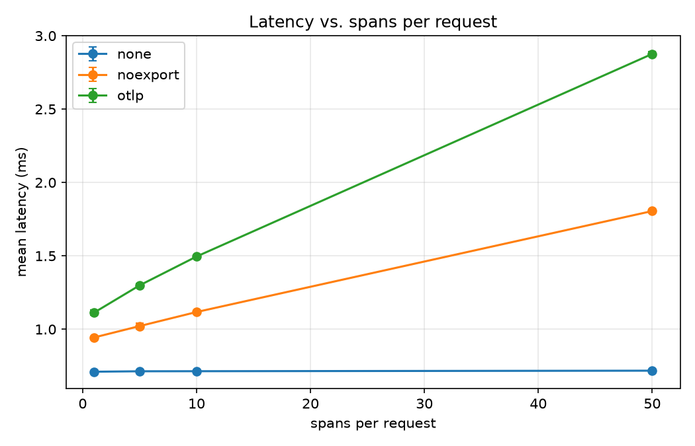

# How much does OpenTelemetry tracing cost a Python web service?

A reproducible benchmark of the per-span overhead of the OpenTelemetry Python SDK in a FastAPI service. It measures how request latency grows with the number of spans created per request, with and without exporting the spans to a collector.

## Setup

Hardware: Intel Core i7-1165G7 laptop (11th gen), Windows 11, plugged in 
Runtime: Docker Desktop, app in `python:3.12-slim`, OpenTelemetry Python SDK 1.45.1 (exact versions in `requirements.txt`) 
Service: FastAPI + uvicorn, one endpoint `/work` 
Collector / backend: OpenTelemetry Collector 0.111.0 and Jaeger 1.62.0 (used by the `otlp` variant) 
Load generator: k6 0.54.0, 1 virtual user 

## Method

Workload: `/work` calls a recursive function of depth N that does a small fixed CPU computation. In the traced variants every call creates one span, so N is the number of spans per request (1, 5, 10 or 50).
Variants:
  - `none`: no tracing code at all
  - `noexport`: spans are created but never exported
  - `otlp`: spans are exported in batches to the collector over OTLP/gRPC
- Per run: fresh containers, 10 s warm-up, then 30 s of measurement (warm-up excluded).
- Repetitions: 5 runs per (variant, N) cell, interleaved so slow drift in the machine does not hit one variant only.
- Statistic: mean request latency of each run, the value reported for a cell is the **median over the 5 runs**. The cost per span is the slope of latency against N.
- One virtual user keeps latency equal to service time. With several concurrent users, requests queue behind the single-threaded server and the latency slope no longer measures cost per span (an earlier version of this experiment with 4 users overstated the slopes by about 4x).

## Results

Median over 5 runs of the mean request latency (ms):

| spans per request | none | noexport | otlp |
| 1 | 0.711 | 0.944 | 1.113 |
| 5 | 0.714 | 1.022 | 1.299 |
| 10 | 0.714 | 1.117 | 1.496 |
| 50 | 0.718 | 1.805 | 2.876 |

Median p99 latency (ms):

| spans per request | none | noexport | otlp |
| 1 | 0.86 | 1.15 | 7.2 |
| 5 | 0.87 | 1.26 | 10.3 |
| 10 | 0.86 | 1.35 | 9.9 |
| 50 | 0.91 | 2.56 | 11.9 |

Points are medians over 5 runs, error bars show the interquartile range.

Raw per-run data is in `results/raw.csv`, aggregated data in `results/summary.csv`.

## Findings

Creating a span costs about **17 µs** (`noexport`), and exporting it through the OTLP batch processor roughly doubles that to about **35 µs** (`otlp`). These are least-squares slopes of median latency against spans per request, relative to `none`.

Tracing also has a fixed cost per request of roughly 0.2 ms (`noexport`) to 0.4 ms (`otlp`). Jaeger shows four extra spans per request that are emitted by FastAPI itself, not by this code. They only appear when a tracer provider is active. Fitting the slope separates this fixed part from the per-span cost.

Export mostly hurts the tail. The p99 is 7 to 12 ms with `otlp` against 1 to 2.6 ms with `noexport`. At 50 spans even the p95 reaches about 8.9 ms (median over runs), so slow requests are more than rare outliers there.

The per-span cost falls slightly with N (for `otlp`, roughly 46 µs between 1 and 5 spans and 34 µs between 10 and 50). Amortised batch work is one plausible explanation, this experiment does not test it.

A possible explanation for the tail latency is the export thread competing with request handling for Python's GIL.

## Limitations

- One machine: a laptop CPU with dynamic boost, and Docker on Windows, which runs in a virtual machine.
- Synthetic CPU-bound workload, no database or network calls in the request path.
- Mean latency is the fitted statistic, tail behaviour is only reported descriptively.
- Two `none` runs (1 and 5 spans, repetition 2) and the first repetition of the traced variants were noticeably slower than the rest, most likely from transient background activity and cold-start effects. They are kept in the raw data, which is why cells are summarised with medians.
- At 50 spans the service creates about 16,000 spans per second under `otlp`. No span-drop warnings were observed in the application log, but that does not prove no spans were dropped.
- Export goes over OTLP/gRPC to a local collector. Other exporters, sampling and the auto-instrumentation path were not measured.

## Reproduce

Requires Docker Desktop and PowerShell.

docker compose build
.\run_all.ps1                 # 60 runs, about one hour, leave the machine idle
pip install numpy matplotlib
python analyze.py             # writes results/summary.csv and results/latency_vs_spans.png

Set the number of repetitions with `$reps` at the top of `run_all.ps1`.

## Files

| File | Purpose |
| `main.py` | FastAPI service; `MODE` and `SPANS` environment variables select the variant and span count |
| `docker-compose.yml`, `Dockerfile` | app, collector, Jaeger and the k6 load profile |
| `otel-collector-config.yaml` | collector pipeline (OTLP in, Jaeger out) |
| `load.js` | k6 script (1 VU, 10 s warm-up, 30 s measurement) |
| `run_all.ps1` | runs every variant and span count, repeated |
| `analyze.py` | aggregates results, fits slopes, plots |